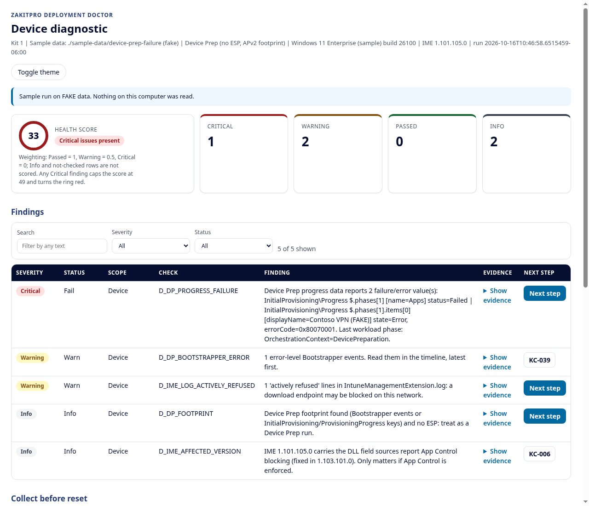
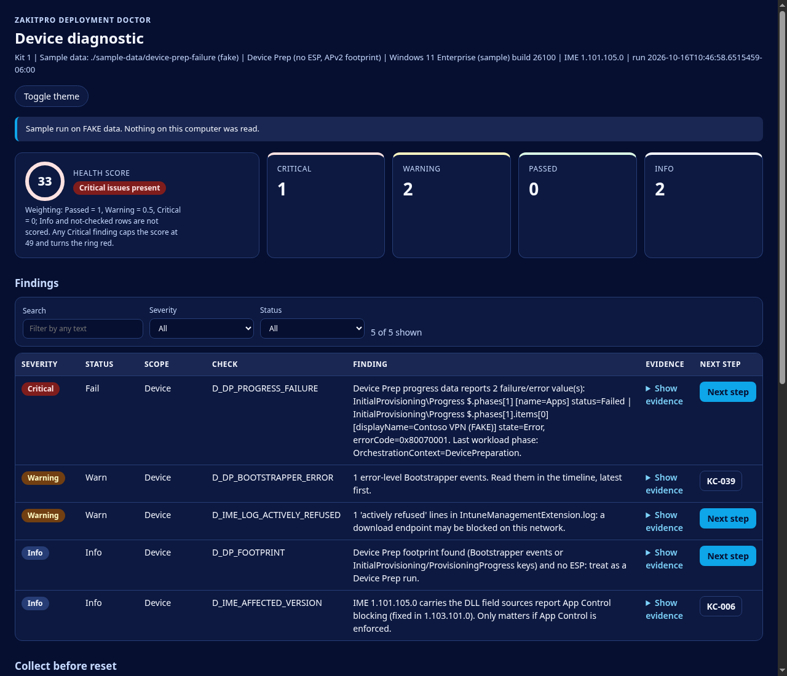

# Autopilot Deployment Doctor (beta scripts)

Read-only PowerShell diagnostics for Windows Autopilot and Windows Autopilot device preparation (Kit 1 scripts v1.3.3), from ZakitPro.

> **Warning: not tested against a live tenant.** These scripts have been checked only with PSScriptAnalyzer and Pester unit tests that use mocked Graph responses and synthetic data. They have not been run on a real tenant or a real device.
>
> **Test in non-production first.** Run them in a test tenant and on a test device before you use them anywhere else. They are provided AS IS under the MIT license, with no warranty.

Join the Deployment Doctor waitlist: https://zakitpro.com/doctor/

## Versions
| Script file | Script version | Matching paid kit version | Last updated |
|---|---|---|---|
| `scripts/Invoke-TenantPreCheck.ps1` | 1.3.3 | Kit 1 v1.4.3 | 2026-10-19 |
| `scripts/Invoke-DeviceDiagnostic.ps1` | 1.3.3 | Kit 1 v1.4.3 | 2026-10-19 |

Script versions are numbered separately from kit (guide) versions: a kit version changes whenever the guide or extras change, while a script version changes only when that script's code changes. The scripts here are byte-identical to the ones in the matching paid kit. See [CHANGELOG.md](CHANGELOG.md).

## How this differs from Pre-Check Lite
The free [Pre-Check Lite](https://zakitpro.com/doctor/) is one script that runs 3 read-only Device Prep tenant checks (service principal, device group, local admin) and prints PASS/FAIL/WARN/SKIP lines. This repo is the full Kit 1 script set: a tenant pre-check and an on-device diagnostic, with HTML/JSON reports.

## Quick start
**PowerShell:** Windows PowerShell 5.1 or PowerShell 7.x (every script has `#Requires -Version 5.1`). The device diagnostic runs on the Windows device itself.

**Graph module (tenant script only):**
```powershell
Install-Module Microsoft.Graph.Authentication -Scope CurrentUser -MinimumVersion 2.0
```
Sign in with an account that can read Intune and Entra (for example Global Reader plus an Intune read-only role). If execution policy blocks a script, review it, then `Unblock-File` that file. Don't set the policy to Bypass globally.

**Run (from the repository root):**
```powershell
# Tenant pre-check (Autopilot / Device Prep). Report folder default: current folder
.\scripts\Invoke-TenantPreCheck.ps1 -TenantId contoso.onmicrosoft.com -OutputPath C:\Temp\DD
# -SkipConnect reuses an existing Connect-MgGraph session.

# Device diagnostic. Run elevated (or as SYSTEM at Shift+F10); without admin it warns and some logs/keys are unreadable.
# Written for Windows PowerShell 5.1, so it also works at Shift+F10 during OOBE.
# Report folder default: $env:TEMP. -ExpectedMode Any|AutopilotV1|DevicePrep
.\scripts\Invoke-DeviceDiagnostic.ps1 -ExpectedMode DevicePrep -OutputPath D:\

# Try it first on FAKE data (reads only the sample folder, nothing on this computer):
.\scripts\Invoke-DeviceDiagnostic.ps1 -SamplePath .\sample-data\device-prep-failure -OutputPath C:\Temp\DD
```
**Report results:** open a [Test report](https://github.com/zakopenc/autopilot-deployment-doctor-beta/issues/new?template=test-report.md). Before you post, remove tenant names, tenant/device/user IDs, UPNs and any secrets, and don't attach unredacted reports.

## What is in this repo
```
scripts/Invoke-TenantPreCheck.ps1     Tenant pre-check (Graph, read-only)
scripts/Invoke-DeviceDiagnostic.ps1   On-device diagnostic (no Graph, no network)
data/known-causes.json                Signal map the scripts need to run (see below)
tests/Kit1.Tests.ps1                  Pester tests
tests/Report.Tests.ps1                HTML report tests
sample-data/                          FAKE datasets for the device script's -SamplePath mode
docs/                                 Sample report (fake data) and its generator
```

46 known causes (30 script-detected, 2 reminder, 14 manual) are referenced by the signal map. `data/known-causes.json` is a trimmed signal map: cause IDs, match signals, status and source links. The scripts load it to label findings, so it is required. The explanations and fixes from the paid kit are not included; reports show "Removed from the beta scripts repo" in their place.

## Local HTML report
Each script writes one self-contained HTML dashboard next to its JSON report. It uses inline CSS and inline vanilla JavaScript only, with no external files, CDNs, web fonts or telemetry. A Content-Security-Policy meta tag blocks network requests from the page.
- **Summary header:** a health score plus status cards (Critical, Warning, Passed, Info). Weighting: Passed = 1, Warning = 0.5, Critical = 0; Info and not-checked rows are not scored. Score = `round(100 x (Passed + 0.5 x Warning) / (Passed + Warning + Critical))`. Any Critical finding caps the score at 49, turns the ring red and shows "Critical issues present".
- **Findings table:** severity pills with text labels, the real status, scope, check, the finding's detail, collapsible HTML-escaped evidence, and a **Next step** link to Microsoft Learn (or the KC/check code when no Learn page exists).
- **Filters, themes, print:** filter by severity/status and search text; light and dark themes (follows `prefers-color-scheme`, plus a toggle); print CSS expands all evidence.
- **`-NoHtml`:** writes only the JSON report. The local report files are the only thing the scripts write.

| Light | Dark |
|---|---|
|  |  |

*Generated by `docs/New-SampleReport.ps1` from invented data. Open [docs/sample-report.html](docs/sample-report.html) locally to try the filters.*

## What each script checks
### `Invoke-TenantPreCheck.ps1` (tenant, read-only Graph)
- Intune Provisioning Client service principal exists (AppID `f1346770-5b25-470b-88bd-d5744ab7952c`).
- Each Device Prep policy's device group: exists, assigned (not dynamic), not role-assignable, owned by that service principal, plus Intune's own validation result.
- Custom Intune roles that appear to carry the enrollment-time device membership permission (heuristic), and whether the device group is in a role assignment's scope.
- Entra "registering user is added as local administrator" vs. Device Prep "Standard user" policies (Warn, not Pass, when that setting can't be read).
- Windows enrollment restrictions blocking personal devices vs. corporate identifiers present.
- ESP profiles whose blocking apps mix LOB MSI and Win32 apps, or include Microsoft 365 Apps (C2R).
- Device Prep app (25) and script (10) caps; selected apps not assigned to the device group.
- Device-context PowerShell scripts that will run during ESP (30-minute timeout).

On a tenant with no Device Prep policy, the service principal and custom-role checks report Info ("Not applicable now"). Sends only GET requests, plus the documented read action `POST .../retrieveEnrollmentTimeDeviceMembershipTarget`. Background: [Windows Autopilot device preparation overview](https://learn.microsoft.com/autopilot/device-preparation/overview).

### `Invoke-DeviceDiagnostic.ps1` (device, no Graph)
Reads ESP tracking and Autopilot/provisioning registry keys, Device Prep (Bootstrapper), ModernDeployment Autopilot (807/809/815/908) and CodeIntegrity 3033 events, IME install state/version and logs (AppWorkload EspPhase lines, "actively refused"), and PowerShell script timeout signals. Builds a phase-ordered timeline and prints the MDMDiagnosticsTool command to run before any reset (it does not run it). Writes only an HTML and a JSON report.

## Microsoft Graph scopes (delegated, read-only)
Taken from the scripts. No ReadWrite scope is requested.

| Script | Scopes |
|---|---|
| Tenant pre-check | `Application.Read.All`, `GroupMember.Read.All`, `Policy.Read.DeviceConfiguration`, `DeviceManagementServiceConfig.Read.All`, `DeviceManagementConfiguration.Read.All`, `DeviceManagementApps.Read.All`, `DeviceManagementRBAC.Read.All` |
| Device diagnostic | None (no Graph, no network) |

The tenant script needs `Microsoft.Graph.Authentication` 2.x.

Several endpoints are Graph `/beta` and can change. Permissions reference: [Microsoft Graph permissions reference](https://learn.microsoft.com/graph/permissions-reference).

## Running the tests
```powershell
Install-Module Pester -MinimumVersion 5.0 -Scope CurrentUser
Install-Module PSScriptAnalyzer -Scope CurrentUser
Invoke-Pester -Path ./tests
```

## Related
- Win32 app scripts: [zakopenc/win32-deployment-doctor-beta](https://github.com/zakopenc/win32-deployment-doctor-beta)
- Autopilot / Device Prep scripts: [zakopenc/autopilot-deployment-doctor-beta](https://github.com/zakopenc/autopilot-deployment-doctor-beta)
- The earlier combined repo, [zakopenc/deployment-doctor-beta](https://github.com/zakopenc/deployment-doctor-beta), is archived.

## License
MIT, see [LICENSE](LICENSE). Third-party credits: [CREDITS.md](CREDITS.md). Checksums: [SHA256SUMS.txt](SHA256SUMS.txt).
